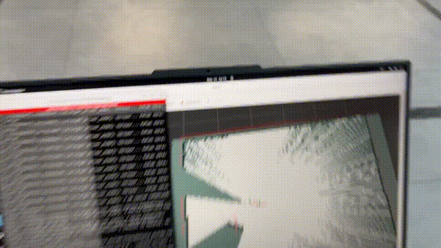

# FAAL — AGV Görev Algoritmaları

**Sanayide Dijital 2026 Yarışması**  
**Takım:** FAAL | **Geliştirici:** Ahmet Selim İlhan  
**Platform:** ROS2 Humble · Ubuntu 22.04 · STM32F407

> Temel navigasyon ve odometri altyapısı için: [faal-robot-base](https://github.com/aSelim-Ilhan/faal-robot-base)

---

## İçindekiler

- [Proje Hakkında](#proje-hakkında)
- [Sistem Mimarisi](#sistem-mimarisi)
- [Görev 1 — Engel Aşma](#görev-1--engel-aşma)
- [Görev 2 — Düz Sürüş ve Haritalama](#görev-2--düz-sürüş-ve-haritalama)
- [Kurulum ve Çalıştırma](#kurulum-ve-çalıştırma)
- [Proje Yapısı](#proje-yapısı)

---

## Proje Hakkında

Bu repo, FAAL aracının yarışma görevlerine ait otonom kontrol algoritmalarını içerir. Her görev bağımsız bir ROS2 node'u olarak yazılmıştır.

**Kullanılan altyapı:**
- **STM32F407** → Micro-ROS üzerinden tekerlek hız verisi yayınlar
- **RPLIDAR S2 M1** → Çevresel engel algılama
- **mps_to_odom.py** → Ham tekerlek hızından odometri hesaplama
- **ROS2 Navigation2 / SLAM Toolbox** → Navigasyon ve haritalama

---

## Sistem Mimarisi

```
STM32F407 (Micro-ROS)
  └─► /faal/mps_info  (sağ/sol tekerlek m/s)
           │
           ▼
     mps_to_odom.py
           │
           └─► /wheel_odom  (konum + yaw açısı)

RPLIDAR S2 M1
  └─► /scan  (360° mesafe verisi)

           │                    │
           ▼                    ▼
    ┌─────────────────────────────────┐
    │        Görev Node'u             │
    │  (Gorev-1.py / Gorev-2.py)      │
    │                                 │
    │  /scan       → engel var mı?    │
    │  /wheel_odom → kaç derece döndüm? │
    └──────────────┬──────────────────┘
                   │
                   └─► /faal/cmd_vel  (hız komutu → STM32)
```

---

## Görev 1 — Engel Aşma

### Demo


[YouTube'da izle](https://youtu.be/zSRH-MrxQ3o)

### Çalışma Mantığı

Araç düz ilerler; önünde engel algıladığında tekerlek odometrisini referans alarak tam **90 derece** döner ve engeli aşar.

```
┌─────────────────────────────────────────────────────┐
│                   DURUM MAKİNESİ                    │
│                                                     │
│   FORWARD ──(engel < eşik)──► STOP                 │
│      ▲                           │                  │
│      │                           ▼                  │
│   FORWARD ◄──(90° tamamlandı)── TURNING            │
│                                                     │
│   Hız: 0.2 m/s ileri                               │
│   Dönüş: tekerlekler arası fark ile yaw takibi      │
│   Engel eşiği: 0.5 m (LIDAR ön 20° dilim)          │
└─────────────────────────────────────────────────────┘
```

**Algoritma Diyagramı:**


### Teknik Detaylar

| Parametre | Değer |
|-----------|-------|
| İleri hız | 0.2 m/s |
| Dönüş hedefi | 90° |
| Engel eşiği | 0.5 m |
| Kontrol frekansı | 10 Hz |
| Yaw kaynağı | `/wheel_odom` (tekerlek odometrisi) |
| LIDAR dilimi | Ön ±10° (merkez 20 ölçüm) |

---

## Görev 2 — Düz Sürüş ve Haritalama

### Demo



[YouTube'da izle](https://youtu.be/oVreA34wx6E)

### Çalışma Mantığı

Araç 20 saniye boyunca sabit hızda düz ilerler. Sürüş tamamlandığında SLAM Toolbox servisi çağrılarak anlık harita diske kaydedilir.

```
Başlat
  │
  ├─► 20 saniye / 0.2 m/s düz sürüş
  │
  ├─► SLAM Toolbox → /slam_toolbox/serialize_map servisini çağır
  │
  └─► Harita ~/haritalar/ dizinine kaydedildi, dur
```

**Algoritma Diyagramı:**


### Teknik Detaylar

| Parametre | Değer |
|-----------|-------|
| İleri hız | 0.2 m/s |
| Sürüş süresi | 20 saniye |
| Harita formatı | SLAM Toolbox serialize |
| Kayıt dizini | `~/haritalar/` |
| Kontrol frekansı | 10 Hz |

### Kaydedilen Haritalar

`haritalar/` klasöründe yarışma sırasında çıkarılan örnek haritalar bulunur:

| Dosya | İçerik |
|-------|--------|
| `my_map.pgm / .yaml` | Ham gri tonlu harita |
| `ros2_map_colored.png` | Renklendirilmiş görselleştirme |
| `ros2_map_visualization.png` | RViz görünümü |

---

## Kurulum ve Çalıştırma

### Bağımlılıklar

```bash
sudo apt install \
  ros-humble-rplidar-ros \
  ros-humble-micro-ros-agent \
  ros-humble-slam-toolbox \
  ros-humble-nav-msgs \
  ros-humble-geometry-msgs
```

### Build

```bash
cd ~/agv_ws
colcon build
source install/setup.bash
```

### Çalıştırma Sırası

```bash
# 1. Micro-ROS Agent (STM32 bağlantısı)
ros2 run micro_ros_agent micro_ros_agent serial --dev /dev/ttyACM1

# 2. RPLIDAR
ros2 run rplidar_ros rplidar_node --ros-args \
  -p serial_port:=/dev/ttyUSB0 \
  -p serial_baudrate:=1000000 \
  -p frame_id:=laser_link

# 3. Tekerlek odometrisi
ros2 run obstacle_avoider mps_to_odom

# 4a. Görev 1 — Engel aşma
ros2 run obstacle_avoider gorev1

# 4b. Görev 2 — Düz sürüş + haritalama (SLAM açıkken çalıştır)
ros2 run obstacle_avoider gorev2
```

---

## Proje Yapısı

```
AGV-GOREVLER/
├── obstacle_avoider/
│   ├── Gorev-1.py        # Engel aşma algoritması (wheel odom + LIDAR)
│   ├── Gorev-2.py        # Düz sürüş + SLAM harita kayıt
│   └── mps_to_odom.py    # STM32 tekerlek hızı → /wheel_odom dönüştürücü
├── haritalar/
│   ├── my_map.pgm / .yaml
│   ├── ros2_map_colored.png
│   └── ros2_map_visualization.png
├── videos/
│   ├── gorev1.gif / .mp4
│   └── gorev2.gif / .mp4
├── package.xml
├── setup.py
└── README.md
```

---

## Bağlantılar

- **faal-robot-base** (navigasyon altyapısı): [github.com/aSelim-Ilhan/faal-robot-base](https://github.com/aSelim-Ilhan/faal-robot-base)
- ROS2 Humble: https://docs.ros.org/en/humble/
- SLAM Toolbox: https://github.com/SteveMacenski/slam_toolbox
- Micro-ROS: https://micro.ros.org/

---

**Geliştirici:** Ahmet Selim İlhan — **Takım:** FAAL — **Yarışma:** Sanayide Dijital 2026
